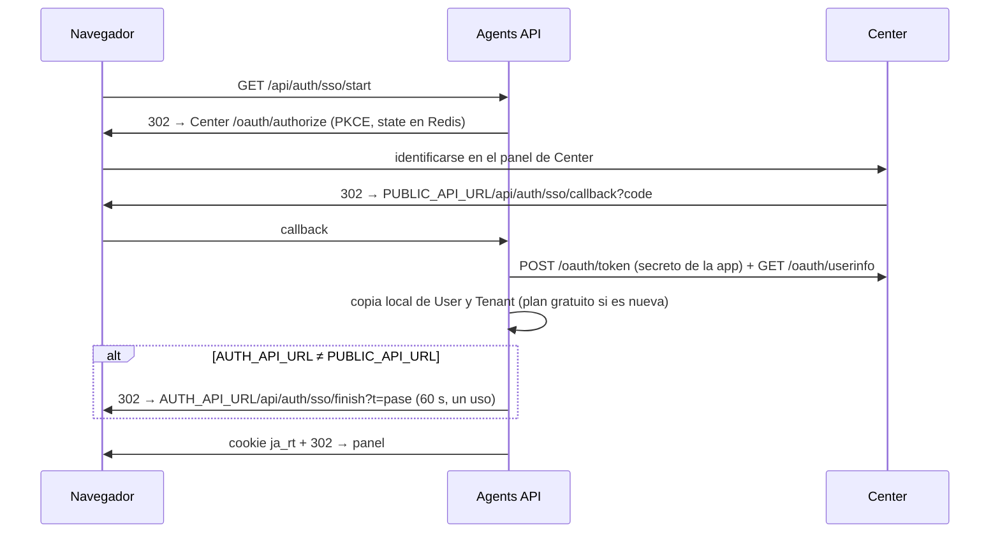
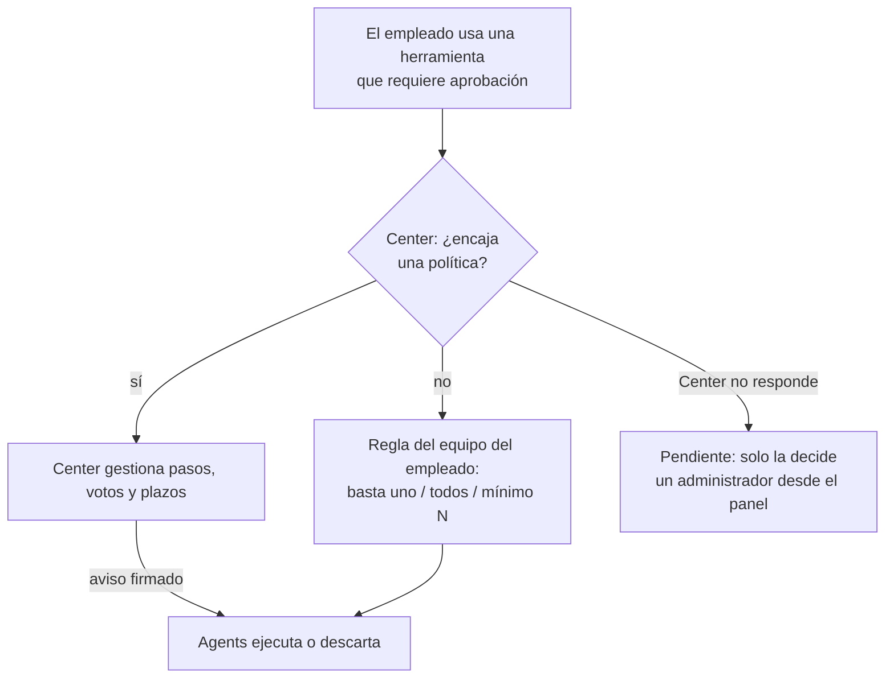

# Arquitectura de JuntialAgents (backend)

> Documento vivo. Si cambias algo de lo que aquí se describe, actualízalo en el mismo *pull request*.
> Visión de conjunto de la plataforma (Center + apps): `docs/CONTRATO.md` y `docs/decisiones/`.

## 1. Qué es y dónde encaja

JuntialAgents es la app de **agentes de IA** de Juntial: bots de Telegram, agentes web (con voz), **empleados digitales** que trabajan solos sobre los sistemas del cliente, un CRM propio con reglas de flujo y funciones JavaScript, conectores MCP, una API pública v1 y un servidor MCP para Claude, ChatGPT y otras apps de IA.

**No es dueña de la identidad ni de la organización**: eso es de **Juntial Center**. Agents guarda copias locales de usuarios y organizaciones (con el mismo id) y le pregunta a Center por permisos, políticas de aprobación, conexiones y tokens del MCP.

```mermaid
flowchart LR
  subgraph Clientes
    P[Panel Agents<br/>React]:::f
    TG[Telegram]:::x
    W[Webs con el widget]:::x
    IA[Claude / ChatGPT<br/>MCP]:::x
    API[Integraciones<br/>API v1]:::x
  end
  subgraph Agents[JuntialAgents]
    A[API<br/>src/server.js]:::s
    K[Worker<br/>src/worker.js]:::s
  end
  C[Juntial Center]:::c
  M[(MongoDB<br/>juntial_agents)]:::d
  R[(Redis<br/>colas · caché · límites)]:::d
  L[Proveedores de IA<br/>Anthropic / OpenAI]:::x
  S[Sistemas del cliente<br/>vía MCP: Zoho, etc.]:::x
  P & TG & W & IA & API --> A
  A <--> M
  A <--> R
  K <--> R
  K <--> M
  A & K -->|API interna, SSO,<br/>introspección| C
  C -->|avisos firmados| A
  K --> L
  K --> S
  classDef f fill:#e6f4f5,stroke:#0E7C86; classDef s fill:#16324F,color:#fff; classDef c fill:#fff4e5,stroke:#b26a00; classDef d fill:#eee; classDef x fill:#fff,stroke:#999
```

## 2. Procesos

| Proceso | Archivo | Qué hace |
|---|---|---|
| **API** | `src/server.js` → `src/app.js` | HTTP: panel, API v1, MCP, webhooks de Telegram, widget, avisos de Center. No hace trabajo pesado: lo encola. |
| **Worker** | `src/worker.js` | Consume las colas de BullMQ: conversaciones de Telegram, empleados digitales, reglas, emails, webhooks, mantenimiento. |
| **Todo en uno** | `src/all.js` | API y worker en un solo proceso, para máquinas pequeñas. Mismo código. |

La API **no guarda estado propio**: se pueden levantar varias copias detrás de un balanceador. Todo el estado compartido vive en MongoDB y Redis.

## 3. Mapa del código

```
src/
  app.js            Montaje de rutas, CORS, seguridad, límites
  server.js         Arranque de la API
  worker.js         Arranque del worker y tareas periódicas
  config/           env.js (variables validadas con zod), logger.js (pino)
  models/index.js   Todos los modelos de Mongoose
  lib/              redis, colas, cifrado, errores, auditoría, métricas, correo, center.js (cliente de Center)
  middleware/       auth.js (sesión), common.js (validación, errores, límites)
  ai/               agent.js (bucle del agente), providers/ (Anthropic, OpenAI), toolset, voz, transcripción
  telegram/         ingress (entrada), router, processor, sender, runtime (caché de bots), buttons
  api/              v1.js (API pública), keyAuth.js (API keys y tokens OAuth), scopes, openapi.js, actions
  jobs/index.js     Trabajos genéricos: envíos, webhooks, emails, mantenimiento
  modules/          Funcionalidades (ver 4)
```

## 4. Módulos (`src/modules/`)

| Módulo | Responsabilidad |
|---|---|
| `auth/` | **SSO con Center** (`sso.js`) y la sesión propia de Agents (`service.js`). |
| `org/` | Permisos por rol (`access.js`), rutas de organización servidas por Center (`routes.js`), avisos firmados de Center (`centerHooks.js`). |
| `bots/` | Alta, configuración y canales de los bots (Telegram, web, worker). |
| `worker/` | **Empleado digital** (el módulo más grande; ver 6). |
| `web/` | Agente web: widget embebible, conversaciones, voz. |
| `crm/` | Contactos, campos personalizados, reglas de flujo (`workflows`), funciones JS en sandbox QuickJS (`sandbox.js`), IDE. `net.js`: protección SSRF. |
| `mcp/` | Conectores MCP de los clientes (Zoho, etc.) y su OAuth. |
| `oauth/` | Servidor **MCP propio** (`mcp.js`) y validación de tokens con Center (`tokens.js`). |
| `tasks/` | Tareas programadas de los bots. |
| `webhooks/` | Webhooks de entrada y de salida de los bots. |
| `plans/` | Planes de Agents, límites y consumo (`limits.js`). |
| `developer/`, `platform/` | API keys y webhooks de plataforma. |
| `support/` | Tickets de soporte. |
| `notifications/` | Avisos al usuario (panel y email) y plantillas. |
| `admin/` | Panel del equipo: organizaciones (copias locales) y planes, auditoría. |

## 5. Datos (MongoDB `juntial_agents`)

| Área | Modelos |
|---|---|
| Identidad (copias de Center) | `User`, `Tenant` (= organización, con su plan de Agents), `Session` |
| Bots y conversación | `Bot`, `ChatContext`, `Message`, `WebConversation`, `McpServer`, `Task`, `Webhook`, `WebhookDelivery`, `BotLog` |
| Empleado digital | `WorkerRun`, `WorkerApproval`, `WorkerRoutine`, `WorkerDoc`, `WorkerFile`, `WorkerMessage`, `WorkerLink` (la configuración del puesto vive en `Bot.worker`) |
| CRM | `CrmRecord`, `CrmActivity`, `FieldDef`, `Workflow`, `WorkflowRun`, `CrmFunction`, `FunctionVersion`, `FunctionRun` |
| Plataforma | `Plan`, `PlanRequest`, `Usage`, `ApiKey`, `ApiRequestLog`, `PlatformWebhook`, `Ticket`, `TicketMessage`, `Notification`, `Audit` |

**Regla de oro: todo dato de cliente lleva `tenantId`, y toda consulta lo filtra.** Es lo que aísla a unas organizaciones de otras.

Los secretos (tokens de Telegram, API keys de IA, credenciales de conectores) se guardan **cifrados** (`lib/crypto.js`, AES-256-GCM con `ENCRYPTION_KEY`). Los tokens que se entregan al usuario se guardan solo como **hash**.

## 6. Colas (Redis + BullMQ)

| Cola | Trabajos | Para qué |
|---|---|---|
| `chat-drain` | mensajes de Telegram | Responder conversaciones (una a la vez por chat). |
| `workers` | `event`, `routine`, `followup`, `heartbeat`, `talk` | Empleados digitales: encargos, rutinas, seguimientos, modo proactivo, conversación por Telegram. |
| `workflows` | reglas, `date-scan` (cada 10 min) | Reglas de flujo del CRM. |
| `scheduled-tasks` | tareas de bots | Tareas programadas. |
| `webhook-out` | webhooks, `wf-hook`, `wk-hook` | Webhooks de salida, con reintentos y firma. |
| `webhook-in` | `api-send`… | Envíos a Telegram desde la API, webhooks de entrada. |
| `email` | `send` | Correo (máx. 10/s). |
| `maintenance` | `session-expiry` (9:00), `model-check` (6:00) | Mantenimiento diario. |

Las tareas programadas de rutinas y modo proactivo se **vuelven a sincronizar desde Mongo** al arrancar el worker, así que sobreviven a un reinicio de Redis.

## 7. Flujos clave

### 7.1 Inicio de sesión (SSO con Center)

La sesión de Agents: access token de 15 min (JWT) + refresh en cookie `ja_rt` (30 días absolutos, rotación en cada uso).

### 7.2 Permisos en cada petición
`requireAuth` (JWT) → `appGuard` (`modules/org/access.js`) pregunta a Center el rol en la app (`admin` · `editor` · `viewer` · `none`), con **60 s de caché**. Si Center no responde, usa los **últimos permisos conocidos** (hasta 24 h); si no hay, responde 503.

### 7.3 Empleado digital (`modules/worker/`)
- `engine.js`: arma el prompt (puesto, guion, equipo, pendientes, diario, aprendizajes), ejecuta el bucle del agente y aplica la **autonomía**: cada herramienta se clasifica por riesgo (`categorize`: `read` · `internal` · `data` · `external` · `destructive`) y la política del puesto decide si se hace sola, si pide aprobación o si está prohibida.
- Un candado por empleado en Redis: si llega un encargo mientras trabaja, **espera su turno** (reintento cada 30 s, hasta 2 h).
- Respuesta: `<aviso>` corto (lo que llega por Telegram o email) y `<detalle>` (solo en el panel).
- Memoria: `worker.memory` (aprendizajes), `worker.threads` (pendientes), `worker.journal` (diario).
- Canales (`channels.js`): panel, Telegram, email, webhook. Conversación (`conversation.js`): Telegram, página personal `/w/<enlace>`, API.

### 7.4 Aprobaciones

Los votos llegan por el panel, Telegram, el enlace personal, el chat o la API, y todos pasan por `voteApproval()`. Los avisos de Center (`/internal/center/approvals`) se verifican por firma y son **idempotentes**.

### 7.5 MCP para Claude y ChatGPT
`/.well-known/oauth-protected-resource` indica que el servidor de autorización es **Center**. Cada token se valida con Center (`/internal/oauth/introspect`, 60 s de caché) y se traduce a los permisos de la API v1.

## 8. Seguridad
- **Aislamiento por `tenantId`** en toda consulta.
- **Secretos cifrados** en la base de datos; los tokens entregados, solo como hash.
- **SSRF**: las peticiones salientes que configura el cliente (conectores, funciones, webhooks) pasan por `crm/net.js`, que bloquea redes internas.
- **Sandbox QuickJS** para las funciones de los clientes: sin `fetch`, `require` ni `process`; solo el SDK `jx`.
- **Webhooks firmados** (HMAC-SHA256) de entrada y de salida.
- **CORS**: abierto solo en `/.well-known` y `/mcp`; `/api` solo para el panel (`WEB_URL`, `CORS_ORIGINS`).
- **Límites de uso** por IP, por usuario, por API key y por plan.

## 9. Configuración
Todas las variables se validan al arrancar (`src/config/env.js`); si falta una obligatoria, el proceso no arranca. Ejemplo comentado en `.env.example`. Las importantes:

| Variable | Para qué |
|---|---|
| `PUBLIC_API_URL` | Dirección pública (webhooks de Telegram, MCP, enlaces). |
| `AUTH_API_URL` | Solo si el panel usa otra dirección (p. ej. local con túnel). |
| `WEB_URL`, `CORS_ORIGINS` | Panel de Agents. |
| `MONGO_URI`, `REDIS_URL` | Datos y colas. |
| `ENCRYPTION_KEY`, `JWT_*` | Cifrado y sesiones. **Cambiar `ENCRYPTION_KEY` deja ilegibles los secretos guardados.** |
| `CENTER_URL`, `CENTER_WEB_URL`, `CENTER_APP_ID`, `CENTER_APP_SECRET` | Conexión con Center. |
| `SMTP_*`, `MAIL_FROM` | Correo. |
| `WORKER_CONCURRENCY` | Conversaciones de Telegram en paralelo. |

## 10. Pruebas
- `npm test`: 31 pruebas (unitarias y de integración) con base simulada (`test/helpers/fakedb.mjs`), IA, Telegram y Center simulados (`test/helpers/setup.mjs`). Necesita Redis (base 15).
- `npm run test:e2e`: Center real + Agents real por HTTP (`test/e2e/`).
- Integración continua: `.github/workflows/ci.yml`.

## 11. Decisiones y deuda conocida
- Decisiones: `docs/decisiones/`.
- **Deuda conocida** (pendiente de abordar):
  - La base simulada no es MongoDB: lo que dependa de comportamientos finos de Mongo (índices únicos, transacciones) conviene probarlo también contra una base real.
  - El chat del panel no tiene todavía su propia batería de pruebas.
  - El paquete del panel supera los 500 kB (sin división de código).
